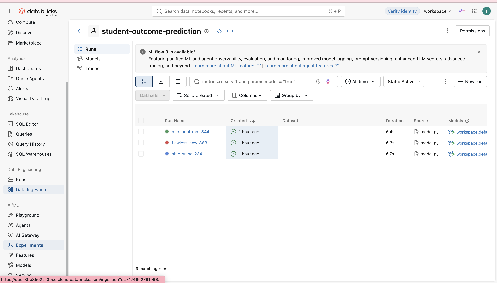
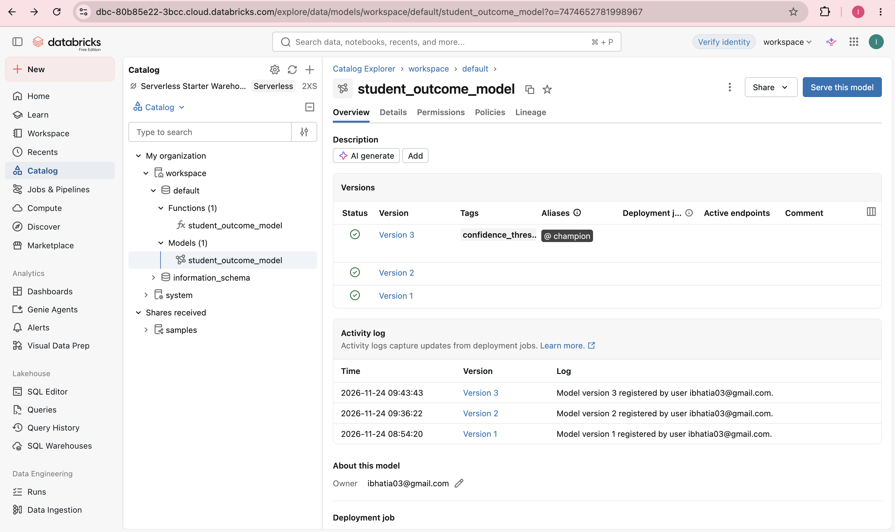

### AI helped generate this README

# Student Outcome Predictor: A Reproducible ML Pipeline

An end-to-end MLOps project. Raw data lives in the cloud and is cleaned by script, dependencies are locked with UV, training is tracked and registered in cloud MLflow, a FastAPI service on Google Cloud Run loads the champion model from the registry, and a Streamlit app calls the API.

- **Live app:** https://510-project3.streamlit.app
- **Live API:** https://student-api-786379901597.us-central1.run.app (interactive docs at `/docs`)
- **Repository:** https://github.com/ishikabhatia12/510-project3

The first request after a quiet period can take up to a minute. The API container wakes up and downloads the model from MLflow.

## Overview and goals

The model predicts a student's outcome (`Dropout`, `Enrolled`, or `Graduate`) from two grades: admission grade and previous qualification grade. The focus of this project is reproducibility.

## Dataset

[Predict Students' Dropout and Academic Success](https://archive.ics.uci.edu/dataset/697/predict+students+dropout+and+academic+success) from the UCI Machine Learning Repository (Realinho et al., 2021; DOI 10.24432/C5MC89; CC BY 4.0). It has 4,424 rows and 37 columns (36 features plus the target). This project uses three columns: `Admission grade`, `Previous qualification (grade)`, and `Target`.

The unmodified raw file is hosted in Supabase Storage. `prepare_data.py` downloads it, keeps the three columns, and writes `students_clean.csv` locally. The clean file is never committed, so every clone rebuilds it from the raw source.

## Exploratory data analysis and column choice

`model.py` prints a data quality check and summary statistics every time it runs. These are the results for the three columns used (4,424 rows).

**Data quality**

- No missing values in any of the three columns.
- Both grade columns are numeric (`float64`), so no encoding is needed.
- 1,286 rows repeat an earlier combination of grades and outcome. That is expected, since different students can share the same grades, so these rows are kept.

Data quality checks use all 4,424 rows; the statistics below use the 3,096-row training set.

**Grade distributions (training set, 3,096 rows)**

| Column | Mean | Std | Min | 25% | Median | 75% | Max |
|---|---|---|---|---|---|---|---|
| Admission grade | 126.9 | 14.5 | 95.0 | 117.8 | 126.0 | 135.0 | 190.0 |
| Previous qualification (grade) | 132.8 | 13.1 | 95.0 | 125.0 | 133.1 | 140.0 | 190.0 |

Both columns cover the same range (95 to 190) with similar spread, so they sit on a comparable scale.

**Outcome balance (training set)**

| Outcome | Rows | Share |
|---|---|---|
| Graduate | 1,546 | 49.9% |
| Dropout | 994 | 32.1% |
| Enrolled | 556 | 18.0% |

The classes are imbalanced, which is why the splits are stratified and why always guessing `Graduate` would be right about half the time. That is the baseline the model has to beat.

**Why these two columns**

I used `Admission grade` and `Previous qualification (grade)` because they are clean, numeric, on a similar scale, and by their names describe a student's record at admission, before the program starts. I did not test which of the 36 features predicts best. The project is about reproducibility and deployment, so I kept the inputs small on purpose. The tradeoff is a weak model, which is why accuracy is close to the always-guess-`Graduate` baseline.

## Reproducibility at a glance

| What | How it is reproducible |
|---|---|
| Dependencies | Locked with UV (`pyproject.toml` and `uv.lock`); `uv sync` recreates the exact environment |
| Data | Raw file hosted in the cloud; cleaning is a script, not a manual step |
| Settings | All in `config.yaml` (data locations, split sizes, seed, threshold, model settings) |
| Splits | Stratified, with a fixed random seed |
| Experiments | Every run logs its settings, metrics, model, and the exact dependency list to MLflow |
| Model delivery | The API loads the `champion` model from the MLflow registry; no model file lives in git or in the Docker image |
| Secrets | Never committed; `.env` is git-ignored, and Cloud Run reads the token from Secret Manager |
| Local vs production | Same code; environment variables decide where MLflow lives (see below) |

## Quick start (runs locally with no accounts)

1. Install [uv](https://docs.astral.sh/uv/). It also installs a compatible Python if needed.
2. Clone and install the locked dependencies:
   ```
   git clone https://github.com/ishikabhatia12/510-project3.git
   cd 510-project3
   uv sync
   ```
3. Build the clean data from the raw cloud file, then train:
   ```
   uv run python prepare_data.py
   uv run python model.py
   ```
4. Serve the API and test it:
   ```
   uv run uvicorn app:app --reload
   ```
   In a second terminal:
   ```
   curl -X POST http://localhost:8000/predict -H "Content-Type: application/json" -d '{"admission_grade": 130, "previous_qualification_grade": 125}'
   ```
   Example response: `{"prediction":"Graduate","confidence":0.49}`
5. Optional: look at your local runs:
   ```
   uv run mlflow ui --backend-store-uri sqlite:///mlflow.db
   ```
   Then open http://localhost:5000.

Without a `.env` file, MLflow runs in local mode: runs and the model registry are stored in `mlflow.db`, using the experiment and model names in `config.yaml`. Run training and the API from the same folder.

## Cloud mode (hosted MLflow)

Copy `.env.example` to `.env` and fill in your Databricks workspace address, access token, experiment path, and model name. The same commands as above now log to and load from the cloud. `.env` is git-ignored.

Environment variables used:

| Variable | Purpose |
|---|---|
| `DATABRICKS_HOST`, `DATABRICKS_TOKEN` | Connect to the Databricks MLflow server |
| `MLFLOW_TRACKING_URI` | `databricks` for cloud, unset for local |
| `MLFLOW_REGISTRY_URI` | `databricks-uc` for the Unity Catalog model registry |
| `MLFLOW_EXPERIMENT_NAME` | Experiment path in the workspace |
| `MLFLOW_MODEL_NAME` | Registered model, for example `workspace.default.student_outcome_model` |

## Experiment tracking and model registry

Training logs to MLflow hosted on Databricks Free Edition:

- **Parameters:** every setting in `config.yaml`, plus the model type
- **Metrics:** validation and test accuracy
- **Artifacts:** the trained model with its signature and the exact dependency list exported from `uv.lock`
- **Registry:** each run registers a new version and points the `champion` alias at it. The confidence threshold is stored as a tag on that version.

The API loads `models:/<model name>@champion`. Moving the alias changes which model is served, with no code change and no git involved.




## Model and evaluation

- **Model:** scikit-learn pipeline of `StandardScaler` followed by `LogisticRegression`
- **Split:** stratified 70% train, 15% validation, 15% test (`validation_size` and `test_size` in `config.yaml`)
- **Results:** validation accuracy 50.15%, test accuracy 49.85%. `Graduate` is about 50% of the training rows, so the model does about as well as always guessing it.
- **Confidence threshold:** `confidence_threshold` in `config.yaml` (default 0.4). The API reads it from the champion model's tags in MLflow and returns `"uncertain"` when the top class probability is below it.

## Docker

```
docker build -t student-api .
docker run --env-file .env -p 8000:8000 student-api
```
The image contains the locked dependencies and `app.py` only. It fetches the champion model from MLflow on startup, so it needs cloud mode settings in `.env`.

## Deploy to the cloud (Google Cloud Run)

Prerequisites: a Google Cloud project with billing, and the `gcloud` CLI signed in. Replace the placeholders with your own values.

Store the token as a secret and let Cloud Run read it:
```
gcloud services enable secretmanager.googleapis.com
grep '^DATABRICKS_TOKEN=' .env | cut -d= -f2- | tr -d '\n' | gcloud secrets create databricks-token --data-file=-
PROJECT_NUMBER=$(gcloud projects describe YOUR-PROJECT-ID --format='value(projectNumber)')
gcloud secrets add-iam-policy-binding databricks-token --member="serviceAccount:${PROJECT_NUMBER}-compute@developer.gserviceaccount.com" --role="roles/secretmanager.secretAccessor"
```
Deploy:
```
gcloud run deploy student-api --source . --region us-central1 --port 8000 --allow-unauthenticated --memory 1Gi --set-env-vars "DATABRICKS_HOST=https://YOUR-WORKSPACE.cloud.databricks.com,MLFLOW_TRACKING_URI=databricks,MLFLOW_REGISTRY_URI=databricks-uc,MLFLOW_MODEL_NAME=workspace.default.student_outcome_model" --set-secrets "DATABRICKS_TOKEN=databricks-token:latest"
```

## Front end

`frontend/streamlit_app.py` takes the two grades, sends them to the deployed API, and shows the prediction. It is hosted on Streamlit Community Cloud from `frontend/requirements.txt`. To run it locally:
```
uv run --with streamlit --with requests streamlit run frontend/streamlit_app.py
```

## Project structure

```
prepare_data.py   downloads the raw data and builds the clean CSV
model.py          trains, evaluates, logs to MLflow, registers the model
app.py            FastAPI service with /predict
config.yaml       data locations, split sizes, threshold, model settings
Dockerfile        container for the API
pyproject.toml    dependencies managed with uv
uv.lock           exact locked versions
frontend/         Streamlit app and its requirements
.env.example      template for environment variables
```

## Cloud services used

| Service | Purpose |
|---|---|
| Supabase Storage | Hosts the raw dataset |
| Databricks Free Edition | MLflow tracking server and Unity Catalog model registry |
| Google Cloud Run | Hosts the FastAPI service |
| Google Secret Manager | Stores the Databricks token for Cloud Run |
| Streamlit Community Cloud | Hosts the front end |

## Ethics and limitations

- **Weak signal:** two grades are a poor basis for predicting outcomes, and accuracy is near the always-guess-the-majority baseline. The `"uncertain"` response keeps the model from sounding more confident than it is.
- **Real-world harm:** a dropout predictor used on real students could label them unfairly, reduce their opportunities, or pull attention away from support they need. It should never drive decisions about individuals. Real use would need human review and fairness testing across student groups.
- **Data scope:** the data comes from one institution, so results may not carry over to other populations.
- **Model promotion:** every training run currently becomes the champion automatically. A production system should promote a new model only when it matches or beats the current champion. 
- **Cloud dependencies:** the live API needs Databricks to be reachable at startup, and Databricks Free Edition has no uptime guarantee. The API loads the model once when the container starts.
- **Hosted copies:** the hosted API and app use my own Databricks workspace and Google Cloud project. Anyone cloning the repository can reproduce everything in local mode, or in cloud mode with their own accounts.